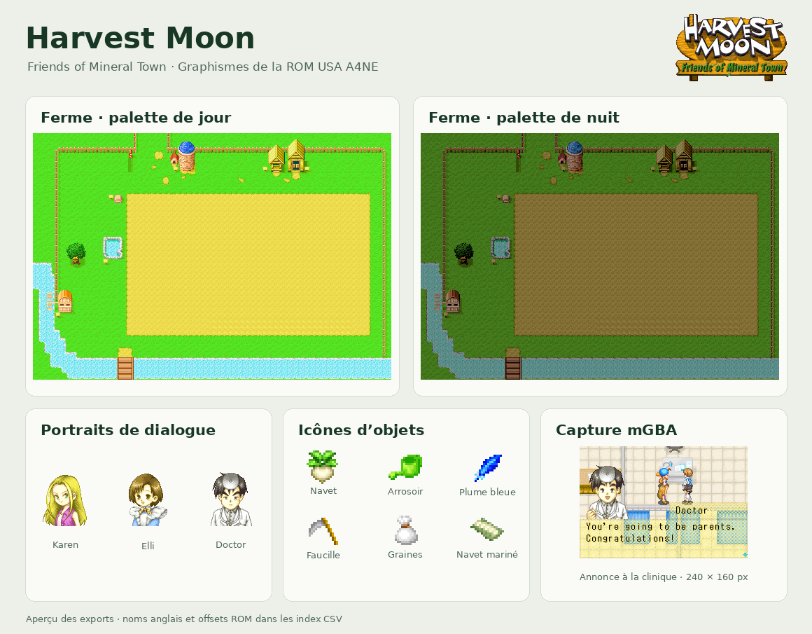

# Harvest Moon: Friends of Mineral Town Disassembly

[Français](README.md) · **English**

This project catalogs, extracts, and documents game data from *Harvest Moon: Friends of Mineral Town* for Game Boy Advance. The reference ROM is the US release (`A4NE`, revision 0). The European release (`A4NP`, revision 0) is used for comparison. The repository also contains a separate event index for *More Friends of Mineral Town* (`BFGE`) and two archived French localization prototypes for `A4NP`. [ROM coverage](docs/couverture-a4ne.md) · [Version details](docs/versions.md)

## What’s in the repository

| Area | Contents | Files |
| --- | --- | --- |
| Dialogue and names | 8,368 event strings in each FoMT release, with script IDs and ROM offsets. The European catalog adds 283 strings read by the game outside event scripts and is available with English or French annotations. The indexes cover 52 character entries and the names and descriptions of 347 inventory items. | [US dialogue CSV](ressources/textes/A4NE/Dialogues-A4NE.csv) · [US dialogue TXT](ressources/textes/A4NE/Dialogues-A4NE.txt) · [Europe, English](ressources/textes/A4NP/en/) · [Europe, French](ressources/textes/A4NP/fr/) · [Text formats and indexes](docs/textes/) |
| Event scripts and triggers | 1,328 scripts per FoMT release. The US index records 696 `CallScript` sites and 459 `SetEntityEventScript` assignments. The notes map 24 family scenes and track 14 script triggers whose normal activation is still under study. | [Event index and bytecode format](docs/evenements/) · [Family events](docs/evenements/vie-de-famille.md) · [Trigger audit](docs/evenements/declencheurs-14.md) · [Regional comparison](docs/comparaison-a4ne-a4np.json) |
| Graphics | 4,577 US PNGs alongside original-format graphics blocks, palettes, indexes, and checksums. The exports include 66 base maps, 84 map renders including night variants, 184 portraits, 3,009 sprite images, 347 item icons, and assets for menus, fonts, the title screen, and the intro. | [Graphics exports](ressources/graphismes/A4NE/) · [Graphics indexes and offsets](docs/graphismes/) · [SHA-256 manifest](ressources/graphismes/A4NE/Manifest-graphismes.csv) |
| Terrain and interactions | 155 terrain descriptors, 214,667 cells read from the ROM, and 722 attribute values used for collision checks and script references. The interaction index locates 9,383 cells by map or overlay and local coordinates. | [Terrain exports](ressources/donnees/terrain/A4NE/) · [Interaction index](ressources/donnees/terrain/A4NE/Interactions-A4NE.csv) · [Terrain format](docs/terrain.md) |
| Items and economy | 347 item records, base stamina and fatigue effects for 171 foods, shipping prices for 103 products, and 12 shop catalogs. The documentation records stock and purchase conditions where identified. | [Economy CSVs](ressources/donnees/economie/A4NE/) · [ROM tables](docs/economie.md) · [Shop conditions](docs/economie-boutiques.md) |
| Farming, cooking, and fishing | 39 field plot types with growth, regrowth, and weather tables. The cooking exports cover 117 recipe definitions, ingredient and utensil lists, and failed cooking outcomes. Fishing tables cover 59 catch entries, with zones, sizes, and seasonal and rod requirements. | [Activity CSVs](ressources/donnees/activites/A4NE/) · [Table formats and rules](docs/activites.md) |
| Character schedules | 32 character descriptors, 254 variant slots (222 with schedules), 1,122 steps, and 430 routes. A separate set of CSVs records 38,400 calls to the ROM’s schedule selectors across the 120 days of Year 1, five weather codes, and two mGBA states at 06:00. Those calls returned 122 distinct variant slots. | [Schedules and routes](ressources/donnees/horaires/A4NE/) · [Selector results](ressources/donnees/selecteurs/A4NE/) · [Selector method and findings](docs/selection-horaires.md) |
| mGBA tests | European gameplay and graphics captures cover shipping, crop planting, gift-giving, and saving and reloading. US captures include normal play and Karen’s pregnancy announcement, reproduced by playing from a prepared state. Video reports record background and sprite palettes, OAM entries, and enabled layers. | [mGBA 0.10.5 guide](docs/mgba/) · [European test report](ressources/mgba/A4NP/Rapport.md) · [US test procedure](docs/mgba/usa-a4ne.md) · [Video measurements](docs/mgba/preuves-video.csv) |
| More Friends of Mineral Town | 1,415 BFGE script slots and 31 family-scene references indexed from published symbols and documentation. The catalogs include pointer-table offsets and identify scenes involving pregnancy, birth, and the child’s development. | [BFGE catalogs and source notes](ressources/evenements/BFGE/) |
| French localization archives | Two European-ROM prototypes with BPS patches, build scripts, text manifests, and screenshots. Version 0.2 includes revisions to the player, farm, and dog naming screens and the **Fini** button. | [Prototype 0.1](ressources/localisation/A4NP/0.1/) · [Prototype 0.2](ressources/localisation/A4NP/0.2/) |



`ressources/` holds the exports and captures. `docs/` holds the technical indexes, formats, and verification notes. `outils/` holds the Python scripts that identify ROMs, index text and events, export data, check graphics indexes, and inspect mGBA states. Most technical notes are in French. On GitHub, use **Raw** or **Download raw file** for large CSV or TXT files. [Resource inventory](ressources/README.md) · [Original ZIP archive checksums](docs/archives-de-travail.md) · [Python tools](outils/)

## ROM versions and offsets

| Code | Game and region | Reference SHA-1 |
| --- | --- | --- |
| `A4NE` | *Friends of Mineral Town*, USA, revision 0 | `a2fc3574f0a65a4fcf7682fb274b9d7eebdef963` |
| `A4NP` | *Friends of Mineral Town*, Europe, revision 0 | `7ba1ec1e46ce424e3c6fd72e4e8d5e9eb5ede247` |
| `BFGE` | *More Friends of Mineral Town*, USA | `3aa4d46cbbf152e440942acd5f5d37ddc7b05e1d` |

The two FoMT reference ROMs are 8,388,608 bytes each. The game code is at file offset `0xAC` and the revision byte is at `0xBC`. Add `0x08000000` to a file offset to obtain its GBA ROM address. The A4NE script pointer table, for example, is at file offset `0x0F89D4` and at address `0x080F89D4` in GBA memory. [ROM headers and regional comparison](docs/versions.md)

## Reproduce the exports

Use Python 3.10 or later and a local copy of the reference ROM. Keep ROM files, game saves, and mGBA save states in your local workspace. The ROM identifier also accepts a ZIP containing a single ROM. Extraction and audit commands use the `.gba` file directly.

```sh
git clone https://github.com/geekandgamer0202-alt/harvest-moon-fomt-disassembly.git
cd harvest-moon-fomt-disassembly
mkdir -p roms exports
```

Place your US ROM at `roms/A4NE.gba`, then run the tools for the data you need. The event and text commands write CSV to standard output. The terrain, economy, activity, and schedule exporters each create a new output directory.

```sh
python3 outils/identifier_rom.py roms/A4NE.gba
python3 outils/evenements/indexer_scripts.py roms/A4NE.gba > exports/scripts-a4ne.csv
python3 outils/evenements/indexer_scripts.py roms/A4NE.gba --appels > exports/appels-a4ne.csv
python3 outils/textes/indexer_textes.py roms/A4NE.gba > exports/index-textes-a4ne.csv
python3 outils/graphismes/verifier_index_a4ne.py roms/A4NE.gba
python3 outils/evenements/exporter_terrain.py roms/A4NE.gba exports/terrain-a4ne
python3 outils/economie/exporter_economie.py roms/A4NE.gba exports/economie-a4ne
python3 outils/jeu/exporter_activites.py roms/A4NE.gba exports/activites-a4ne
python3 outils/jeu/exporter_horaires.py roms/A4NE.gba exports/horaires-a4ne
```

For regional comparison, add your European ROM as `roms/A4NP.gba`. For the emulator example, record a state while the farmhouse bed dialogue is open and save it as `exports/mgba/sommeil-a4ne.state`. [mGBA setup and state inspection](docs/mgba/) · [US test procedure](docs/mgba/usa-a4ne.md)

```sh
python3 outils/evenements/indexer_scripts.py roms/A4NE.gba --comparer roms/A4NP.gba
python3 outils/evenements/indexer_scripts.py roms/A4NE.gba --audit-quatorze
python3 outils/evenements/auditer_terrain.py roms/A4NE.gba 0342
python3 outils/mgba/inspecter_etat.py --rom roms/A4NE.gba exports/mgba/sommeil-a4ne.state
```

The schedule selector procedure runs the ROM routines in isolation with Unicorn. It varies the date and weather while holding the other state fields fixed. [Schedule selector procedure](docs/selection-horaires.md#refaire-le-relevé)

## Coverage still in progress

Open work includes native US text outside event scripts, unresolved triggers and schedule conditions, map transitions and overlay placement, remaining interfaces and minigames, livestock data, and the on-cartridge save format. The M4A song table at `0x13ABF0` has 211 entries. Sequence, instrument bank, sample, and loop extraction is pending. The coverage notes also track the planned inventory of ROM byte ranges. [Detailed coverage and open areas](docs/couverture-a4ne.md)

[Wokann FoMT disassembly](https://github.com/Wokann/fomt) · [StanHash’s event script format notes](https://github.com/StanHash/FOMT-DOC/blob/master/EventScripts.txt) · [mGBA 0.10.5](https://github.com/mgba-emu/mgba/releases/tag/0.10.5)
