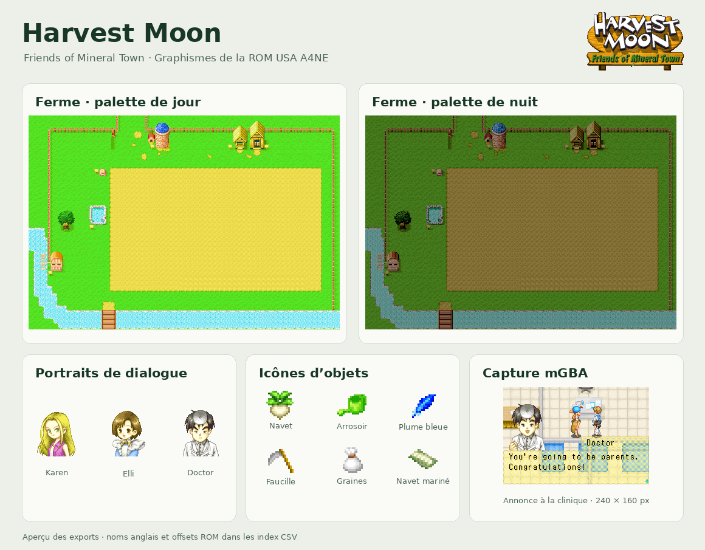

# Désassemblage de Harvest Moon: Friends of Mineral Town

Ce dépôt documente les textes, les événements et les graphismes de *Harvest Moon: Friends of Mineral Town* sur Game Boy Advance pour préparer une traduction française. L’édition américaine **A4NE** sert de référence pour le désassemblage. L’édition européenne **A4NP** sert à la comparaison et aux premiers essais de localisation.

## Accès rapide

| Pour trouver… | Fichiers à ouvrir |
| --- | --- |
| Une réplique et son emplacement | [Dialogues USA en CSV](ressources/textes/A4NE/Dialogues-A4NE.csv) · [Dialogues USA en TXT](ressources/textes/A4NE/Dialogues-A4NE.txt) · [Catalogues Europe](ressources/textes/A4NP/) |
| Un personnage ou un objet | [Noms des personnages](docs/textes/Personnages.csv) · [Objets et descriptions](docs/textes/Libelles-objets-A4NE.csv) · [Icônes nommées](docs/graphismes/objets/Index-icones-objets-A4NE.csv) |
| Le déclencheur d’une scène | [Événements et appels](docs/evenements/) · [Vie de famille](docs/evenements/vie-de-famille.md) · [Audit des 14 déclencheurs](docs/evenements/declencheurs-14.md) |
| Une carte, un portrait ou un sprite | [Dossier des graphismes](ressources/graphismes/A4NE/) · [Aperçu](ressources/graphismes/A4NE/Apercu.png) · [Index et offsets graphiques](docs/graphismes/) |
| Une procédure ou une capture mGBA | [Guide mGBA 0.10.5](docs/mgba/) · [Captures Europe](ressources/mgba/A4NP/captures/) · [Captures USA](ressources/graphismes/A4NE/mgba/) |
| Les premiers essais de traduction | [Prototype 0.1](ressources/localisation/A4NP/0.1/LISEZMOI.md) · [Prototype 0.2](ressources/localisation/A4NP/0.2/LISEZMOI.md) |

`ressources/` contient les textes, images, fichiers graphiques natifs et rapports. `docs/` contient les index techniques et les résultats de vérification. `outils/` contient les scripts Python. Pour consulter un gros CSV ou TXT sur GitHub, utiliser **Raw** ou **Download raw file**. [Inventaire des ressources](ressources/README.md) · [Empreintes des ZIP d’origine](docs/archives-de-travail.md)

## Éditions et adresses de référence

| Code | Édition | Révision | SHA-1 de référence |
| --- | --- | ---: | --- |
| `A4NE` | *Friends of Mineral Town*, USA | 0 | `a2fc3574f0a65a4fcf7682fb274b9d7eebdef963` |
| `A4NP` | *Friends of Mineral Town*, Europe | 0 | `7ba1ec1e46ce424e3c6fd72e4e8d5e9eb5ede247` |
| `BFGE` | *More Friends of Mineral Town*, USA | — | `3aa4d46cbbf152e440942acd5f5d37ddc7b05e1d` |

Les ROM A4NE et A4NP analysées font chacune 8 388 608 octets. Le code d’édition se lit à l’offset `0xAC`, et la révision à `0xBC`. Les adresses des index sont des offsets dans le fichier. Pour les convertir en adresses ROM GBA, ajouter `0x08000000`. Par exemple, la table de scripts A4NE à `0x0F89D4` correspond à `0x080F89D4` en mémoire. [Empreintes, en-têtes et comparaison](docs/versions.md)

L’indice communautaire à l’adresse `0x080000A0` correspond à l’en-tête BFGE de *More Friends of Mineral Town*. Son index de 1 415 emplacements et ses 31 repères familiaux proviennent du catalogue de symboles et de la documentation. Les scripts et offsets A4NE ci-dessous concernent *Friends of Mineral Town*. [Dossier BFGE](ressources/evenements/BFGE/) · [Lecture de l’indice](docs/versions.md#lindice-communautaire-bfge)

## Textes et localisation

Les éditions A4NE et A4NP ont chacune **8 368 chaînes d’événement**. Le catalogue Europe ajoute **283 chaînes natives** issues des menus et autres lecteurs directs. Ses versions française et anglaise changent la langue des annotations et conservent le texte d’origine du jeu. [Catalogue Europe en français](ressources/textes/A4NP/fr/) · [Catalogue Europe en anglais](ressources/textes/A4NP/en/)

Un identifiant comme `0162.00` désigne la première chaîne du script `0162`. Il permet de retrouver le panneau de la caisse d’expédition à `0x2CC120` en A4NE ou à `0x2CC178` en A4NP. Les exports de dialogues indiquent l’ID, l’offset, la longueur et le contexte de la chaîne. La colonne `fr` reçoit la traduction. Préserver les commandes utiles, dont `05` pour attendre une action, `0C` pour changer de page et `FF21` pour insérer le nom du joueur. [Index et codes de contrôle](docs/textes/)

Les **52 entrées de personnages** couvrent les noms affichés, les rôles et les noms issus de la sauvegarde. Les tables d’inventaire comptent **347 objets** répartis en 81 outils, 171 aliments et 95 articles. Leurs noms et descriptions ont été comparés dans les deux éditions. [Catalogue des personnages](docs/textes/Personnages.csv) · [Libellés A4NE](docs/textes/Libelles-objets-A4NE.csv) · [Libellés A4NP](docs/textes/Libelles-objets-A4NP.csv)

Le prototype français **0.2** concerne A4NP et couvre 31 entrées d’interface. Les champs **Ton nom**, **Ta ferme** et **Ton chien** placent le premier caractère et le curseur à `x = 112`. Le bouton **Fini** valide la saisie. Les essais mGBA ont vérifié la saisie jusqu’au douzième caractère et le récapitulatif des trois noms. La réinsertion des dialogues de longueur variable, les autres glyphes accentués et la localisation A4NE restent à valider. [Essai 0.2 et captures](ressources/localisation/A4NP/0.2/LISEZMOI.md) · [Offsets de l’interface](docs/textes/README.md#saisie-du-joueur-de-la-ferme-et-du-chien)

## Événements et déclencheurs

Les tables des **1 328 scripts** commencent à `0x0F89D4` en A4NE et à `0x0F8A20` en A4NP. Chaque bloc `RIFF/SCR` peut contenir le bytecode `CODE`, une table de sauts `JUMP` et les chaînes `STR`. La comparaison des ROM confirme l’égalité de `CODE` et `JUMP`. Seule `1008.00`, dans la présentation de Karen, diffère parmi les chaînes d’événement. [Structure des scripts](docs/evenements/README.md#structure-vérifiée) · [Comparaison A4NE/A4NP](docs/comparaison-a4ne-a4np.json)

- **Appels et dialogues.** L’index A4NE relève 696 appels `CallScript` et 459 affectations `SetEntityEventScript`. Les affectations associent un dialogue à un acteur pour une interaction ultérieure. Les conditions dépendent du branchement qui mène à l’instruction. [Sites d’appel](docs/evenements/appels-a4ne.csv)
- **Vie de famille.** Le sommeil passe par `0342 → 0988 → 0980 → 0982 → 0983`. Le planificateur `0983`, à l’offset A4NE `0x390C7C`, sélectionne les branches selon le mariage, l’affection, la date et la progression familiale. L’analyse statique situe 24 scènes. Dans mGBA, le lit `0342` a été observé en partie neuve. Le jeu a sélectionné le script `0657` de Karen et a affiché l’annonce `0657.03` après un sommeil ordinaire depuis une copie d’état préparée en RAM. [Conditions et scènes](docs/evenements/vie-de-famille.md) · [Procédure Karen](docs/mgba/usa-a4ne.md#test-ciblé-de-karen)
- **Quatorze déclencheurs.** La recherche a couvert les appels et affectations indexés ainsi que 214 667 cellules de terrain par édition, avec zéro référence vers les 14 identifiants dans ces mécanismes. Des essais Europe ont confirmé des interactions voisines, comme la bibliothèque d’Ellen via `0191`. L’accès en jeu normal aux blocs recherchés reste à établir là où l’audit n’a trouvé que des indices. [Résultats par script](docs/evenements/declencheurs-14.md)

## Graphismes et captures mGBA



L’extraction graphique A4NE compte **4 577 PNG** et conserve les index, les palettes et les blocs graphiques natifs. [Guide des fichiers](ressources/graphismes/A4NE/Lire-moi.md) · [Manifeste SHA-256](ressources/graphismes/A4NE/Manifest-graphismes.csv)

| Famille | Contenu | Repère A4NE |
| --- | --- | --- |
| Cartes | 66 plans de base, 84 compositions avec les variantes de nuit, 31 jeux de tuiles et 47 palettes. | `gMapData` à `0x105EDC` · [Index des plans](docs/graphismes/cartes/Cartes.csv) |
| Portraits et sprites | 184 portraits, 3 009 images de sprites et 2 551 sélecteurs d’animation. | Archives à `0x52D984` et `0x58BA28` · [Planches](ressources/graphismes/A4NE/personnages/Planches/) |
| Icônes et groupes OBJ | 347 icônes d’inventaire et 52 archives OBJ supplémentaires, dont 939 groupes graphiques composés. | Archive commune à `0x6678A0` · [Archives OBJ](docs/graphismes/archives-obj/Archives-OBJ.csv) |
| Interface | Titre, menus, polices, fonds et écrans d’introduction. | [Plages ROM dans l’index de l’interface](docs/graphismes/interface/Interface.csv) |

Les cartes représentent les décors statiques. Les personnages, la météo, les cultures et les animations s’ajoutent selon l’état du jeu. Les **six relevés mGBA 0.10.5** documentent les palettes de décor (BG), les palettes de sprites (OBJ), les entrées OAM et les couches actives. Quatre proviennent d’une partie normale et deux du test préparé de Karen. Les mesures décrivent les données chargées et les objets dans le cadre avant la composition de l’image finale. [Relevés vidéo](docs/mgba/preuves-video.csv) · [Vues de diagnostic mGBA](docs/mgba/graphismes.md)

## Reproduire les vérifications

Les exemples utilisent **Python 3.10 ou ultérieur** et des copies locales des ROM d’origine. Après avoir cloné le dépôt avec ton compte GitHub, placer les copies sous `roms/A4NE.gba` et, pour la comparaison ou l’essai français, `roms/A4NP.gba`. Les ROM, sauvegardes et états mGBA restent dans l’environnement de test.

```sh
git clone https://github.com/geekandgamer0202-alt/harvest-moon-fomt-disassembly.git
cd harvest-moon-fomt-disassembly
mkdir -p roms exports
```

Vérifier d’abord le code et l’empreinte. L’identificateur accepte également un ZIP contenant une seule ROM. Les indexeurs de scripts et de textes utilisent le fichier `.gba` et produisent leurs CSV sur la sortie standard.

```sh
python3 outils/identifier_rom.py roms/A4NE.gba
python3 outils/evenements/indexer_scripts.py roms/A4NE.gba > exports/scripts-a4ne.csv
python3 outils/evenements/indexer_scripts.py roms/A4NE.gba --appels > exports/appels-a4ne.csv
python3 outils/textes/indexer_textes.py roms/A4NE.gba > exports/index-textes-a4ne.csv
python3 outils/graphismes/verifier_index_a4ne.py roms/A4NE.gba
```

Pour refaire la comparaison régionale ou les recherches de références, utiliser les commandes suivantes. `auditer_terrain.py` accepte aussi des identifiants décimaux en arguments pour localiser un script précis.

```sh
python3 outils/evenements/indexer_scripts.py roms/A4NE.gba --comparer roms/A4NP.gba
python3 outils/evenements/indexer_scripts.py roms/A4NE.gba --audit-quatorze
python3 outils/evenements/auditer_terrain.py roms/A4NE.gba 0342
```

Avec mGBA Qt installé, une ROM A4NP de référence et le BPS du dépôt, lancer le prototype par la commande ci-dessous. Pour enregistrer un état, identifier le script en cours ou reprendre le test de grossesse, suivre les procédures avec leurs états de départ. [Guide mGBA](docs/mgba/) · [Parcours USA](docs/mgba/usa-a4ne.md) · [Parcours Europe](docs/mgba/europe-a4np.md)

```sh
mgba-qt -p ressources/localisation/A4NP/0.2/Harvest-Moon-A4NP-FR-0.2.bps roms/A4NP.gba
```

Pour ajouter un relevé reproductible, préciser l’édition, l’ID ou l’offset, la situation en jeu et l’outil utilisé. Les rapports distinguent les observations en partie normale, les essais sur un état préparé et la lecture statique de la ROM. [Désassemblage FoMT de Wokann](https://github.com/Wokann/fomt) · [Format des scripts d’événement](https://github.com/StanHash/FOMT-DOC/blob/master/EventScripts.txt) · [mGBA 0.10.5](https://github.com/mgba-emu/mgba/releases/tag/0.10.5)
